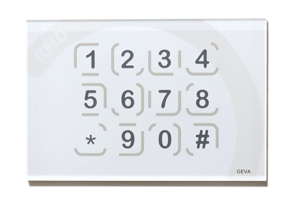
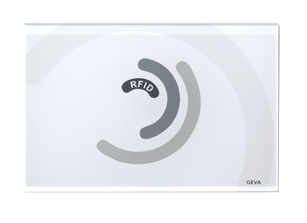
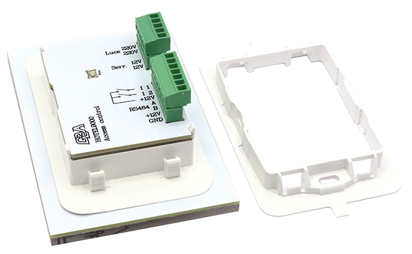

# GEVA TR20 — open firmware



**TR20** is a wall-mounted **RFID card reader with a 12-key capacitive touch keypad** for hotel and
access-control installations, connected to the supervisor over an **RS485 / Modbus RTU** bus.
It is designed and manufactured by **[GEVA Elettronica](https://www.gevaelettronica.it)** (Italy).

This repository contains the **complete, buildable firmware source** of the TR20, published as
**open firmware** so that integrators and customers can read it, change the behaviour and load
their own build onto the reader.

> Writing or modifying TR20 firmware with an AI coding assistant? Read **[AGENTS.md](AGENTS.md)** —
> the LLM / agent programming guide for this board.

---

## Highlights

- **ATmega328PB** (AVR 8-bit), 32 KB flash, 2 KB RAM, running at **8 MHz** (16 MHz crystal, `CLKPR` = /2).
- **12-key capacitive touch keypad** driven by the Microchip **QTouch** (PTC) library.
- **RFID reader** for ISO/IEC 14443-A cards (MIFARE), based on the NXP **MFRC630** over SPI.
- **2 relay outputs**: `K1` (door lock) and `K2` (room light).
- **Feedback**: piezo buzzer (musical notes), vibration motor, red and green LED rings.
- **2 digital inputs** plus a **setup/reset contact**.
- **RS485 half-duplex** bus with precise `TxEn` handling (release on the UART TXC interrupt, so no
  transients corrupt the bus).
- **Modbus RTU slave** (PetitModbus): functions **03**, **06**, **16**, 30 holding registers.
- **Field configuration from the keypad**: Modbus address, baud rate and keypad enable, stored in
  EEPROM.
- **Firmware update over the RS485 bus** with a resident bootloader — no programmer needed.

---

## Repository contents

| Path | Description |
|------|-------------|
| [`TR20-Modbus/`](TR20-Modbus/) | **Main firmware**: Modbus RTU slave with RFID, keypad, relays and feedback. This is the one shipped on the reader. |
| [`TR20-Test/`](TR20-Test/) | **Bench-test firmware**: no Modbus, exercises keypad, RFID, relays, buzzer and vibration. A minimal starting point for custom firmware. |
| [`Library/`](Library/) | Shared sources used by both projects (hardware abstraction, timer, MFRC630 driver, PetitModbus stack). |
| [`docs/`](docs/) | [Modbus register map](docs/modbus-register-map.md), [configuration from the keypad](docs/configuration.md), [firmware upload](docs/firmware-upload.md). |
| [`AGENTS.md`](AGENTS.md) | Programming guide for LLMs / AI coding agents (and for humans in a hurry). |
| [`llms.txt`](llms.txt) | LLM-friendly map of the repository ([llmstxt.org](https://llmstxt.org) convention). |

Both MPLAB projects reference the shared code as `../Library/...`, so **keep the folder layout as it
is** — `Library/` must stay a sibling of the project folders.

---

## Toolchain

| Tool | Version used | Notes |
|------|--------------|-------|
| **MPLAB X IDE** | v6.30 or newer | or the **MPLAB extensions for VS Code** (see below) |
| **MPLAB XC8** | v3.10 (v3.00 also builds) | AVR support, `pro`/free mode both work |
| **ATmega_DFP** device pack | 3.4.282 | installed by MPLAB X / the VS Code extensions |
| **MPLAB Code Configurator (MCC)** | — | only needed to regenerate `mcc_generated_files/` |

### Does the VS Code extension install the compiler?

**No.** The *MPLAB extensions for VS Code* (extension pack: *MPLAB*, *Toolchain Support for MPLAB*,
*MPLAB Debugger*, …) only integrate the toolchain into VS Code — they do **not** bundle XC8.
You must install the **XC8 compiler** separately from Microchip's site (the Microchip guides list
XC8 installation as its own step and tell you to verify that `xc8-cc --version` runs in the VS Code
terminal). The device family pack is downloaded by the extension or by MPLAB X.

So: install **XC8 v3.10+** first, then the VS Code extensions (or MPLAB X IDE), then open the
project.

---

## Building

### MPLAB X IDE

1. **File → Open Project…** and pick `TR20-Modbus` (or `TR20-Test`).
2. Select the `default` configuration and press **Build** (hammer icon).
3. The HEX lands in `TR20-Modbus/dist/default/production/TR20-Modbus.production.hex`.

### VS Code (MPLAB extensions)

1. Open the workspace `TR20-Modbus/TR20-Modbus.code-workspace` (it also mounts `Library/`).
2. The project definition is `.vscode/TR20-Modbus.mplab.json`; the extension generates the CMake
   files and builds with Ninja into `_build/`.
3. Run the **MPLAB: Build** command (or the `Build HEX` task).

### Command line

`make` works only **after** MPLAB X has built the project once, because it generates two things
that are intentionally not in the repository (they hold machine-specific paths): the local makefile
`nbproject/Makefile-local-default.mk` and the `.generated_files/flags/` markers the rules depend on.
Once they exist:

```powershell
make -C TR20-Modbus build
```

Generated build output (`build/`, `dist/`, `out/`, `_build/`, `cmake/`, `.generated_files/`) is
git-ignored — don't commit it.

### Compiler settings that matter

Both project files set XC8 `pro` optimisation, `-fno-common`, function/data sections with
`--gc-sections`, `-mconst-data-in-progmem`, and the include paths `../Library`,
`mcc_generated_files`, `.`. The QTouch binary libraries in `mcc_generated_files/touch/libraries/`
are linked in. **Keep these settings** — the firmware is close to the flash budget left by the
bootloader.

> The two build paths are not identical: the MPLAB X project (`nbproject/`) uses **`-Os`** and no
> LTO, while the VS Code project (`.vscode/TR20-Modbus.mplab.json`) requests **`-O3`** with WPO/LTO.
> Both build, but they produce different code sizes. Check the program-memory figure against the
> 0x3E00 limit with whichever path you use, and prefer the MPLAB X settings for a release build.

---

## Loading the firmware onto the reader

The TR20 has a **resident bootloader**, so no programmer or debugger is needed: you flash it
**through the same RS485 bus** it uses for Modbus.

You need:

- a **USB → RS485 adapter**,
- the **Bootloader** PC application, from <https://download.gevaelettronica.it/Hotel/>,
- the `.hex` produced by the build.

Full step-by-step: **[docs/firmware-upload.md](docs/firmware-upload.md)**.

> ⚠️ **The application must stay below the bootloader, which lives at 0x3E00** (15872 bytes). There
> is very little room left: the current V6 firmware builds to **15 627 bytes of flash and 948 bytes
> of RAM** with the free XC8 v3.10 (which ignores the project's `-Os` request — the PRO compiler
> produces a smaller image). That is **245 bytes of headroom**. Check the program-memory figure
> after *every* build before uploading.

---

## How the firmware behaves

### Main firmware (`TR20-Modbus`)

The reader is a **Modbus RTU slave**. It publishes what it reads (keypad buffer, card UID, inputs)
and accepts commands (relays, buzzer, vibration, LEDs, "OK" and "error" sequences) in its holding
registers. The supervisor polls it; all of the access logic lives on the supervisor, not in the
reader.

- The complete register map is in **[docs/modbus-register-map.md](docs/modbus-register-map.md)**.
- Modbus address, baud rate and keypad enable are set **from the keypad** and stored in EEPROM —
  see **[docs/configuration.md](docs/configuration.md)**.
- The green LED gives a short "life" blink every 1.5 s (can be disabled from Modbus).

### Bench-test firmware (`TR20-Test`)

No Modbus: at power-up it plays a tone, then reads the keypad and the RFID field and toggles the
relays from the digital inputs. It is the smallest complete example of using the hardware layer and
a good base for a custom firmware.

---

## Hardware layer in brief

Everything the application touches is in [`Library/TR20_hw.h`](Library/TR20_hw.h) — read that file
rather than guessing names.

| Macro / function | What it does |
|------------------|--------------|
| `initHw()` | Initialises MCC peripherals, the 1 ms tick, the MFRC630 and the touch system. Call it once. |
| `millis()`, `delay(ms)` | 1 ms tick from TC3. |
| `Key(&k)` | Returns `true` once per touch; `k` = key index `0…11`. |
| `rfid()` | Returns `true` once per newly presented card; the UID is in the global `uid[]`. |
| `play(freq, ms)` | Buzzer tone; note constants `DO4 … SI7` are defined in the header. |
| `SetK1` / `ResK1`, `SetK2` / `ResK2` | Lock relay, light relay. |
| `SetRedLed` / `ResRedLed`, `SetGreenLed` / `ResGreenLed` | LED rings. |
| `SetVibro` / `ResVibro` | Vibration motor. |
| `ckIn1`, `ckIn2`, `ckRes` | Digital inputs and the setup contact. |
| `set_TxEn` / `res_TxEn` | RS485 transmit enable. |
| `readEEPROM` / `writeEEPROM` (+ `_block`) | Interrupt-safe EEPROM access. |

The relay, LED and vibration lines hang off the **MFRC630 GPIO port**, not off AVR pins: the `Set…`
/ `Res…` macros write the shadow variable `out` **and** push it to the chip. The `…_` variants
(e.g. `SetK1_`) only change the shadow — then one `Act` writes everything at once.

---





## Buy / contact

- Website: <https://shop.gevaelettronica.it>
- Email: info@gevaelettronica.it
- Bootloader and tools: <https://download.gevaelettronica.it/Hotel/>

## License

The GEVA firmware and the hardware layer are released under the **MIT** license — see
[LICENSE](LICENSE).

Third-party components keep their own licenses and attribution, in their source headers:

- `Library/mfrc630.*`, `Library/mfrc630_def.h` — MFRC630 driver by **Ivor Wanders** (MIT).
- `Library/PetitModbus/` — Petit Modbus RTU slave by **Firat Deveci**, with GEVA modifications.
- `*/mcc_generated_files/` and the QTouch libraries — **Microchip Technology Inc.**, usable
  exclusively with Microchip products under Microchip's own terms.
